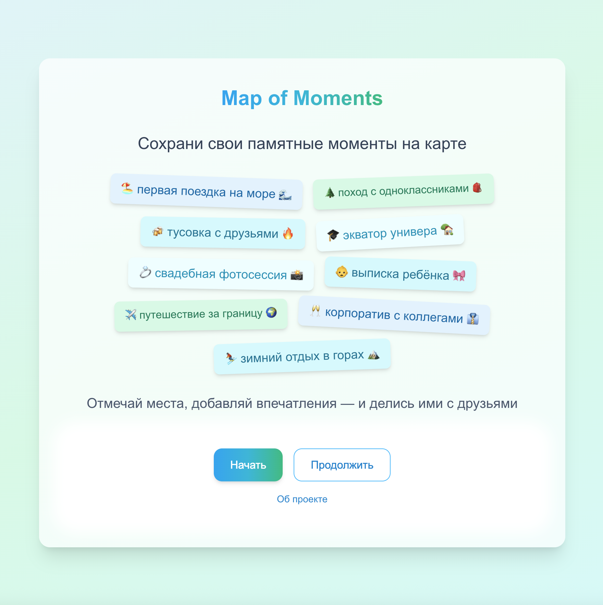
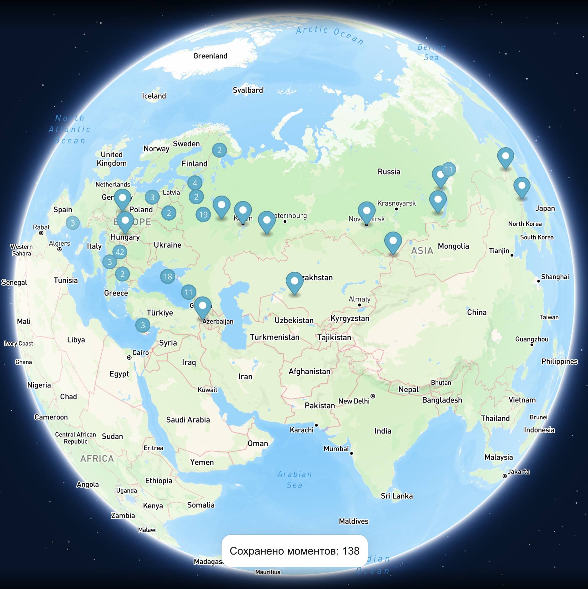
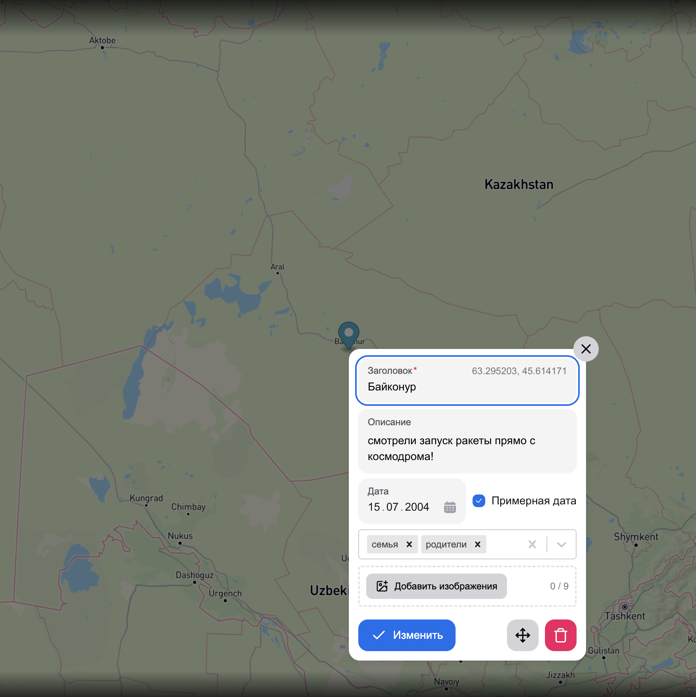
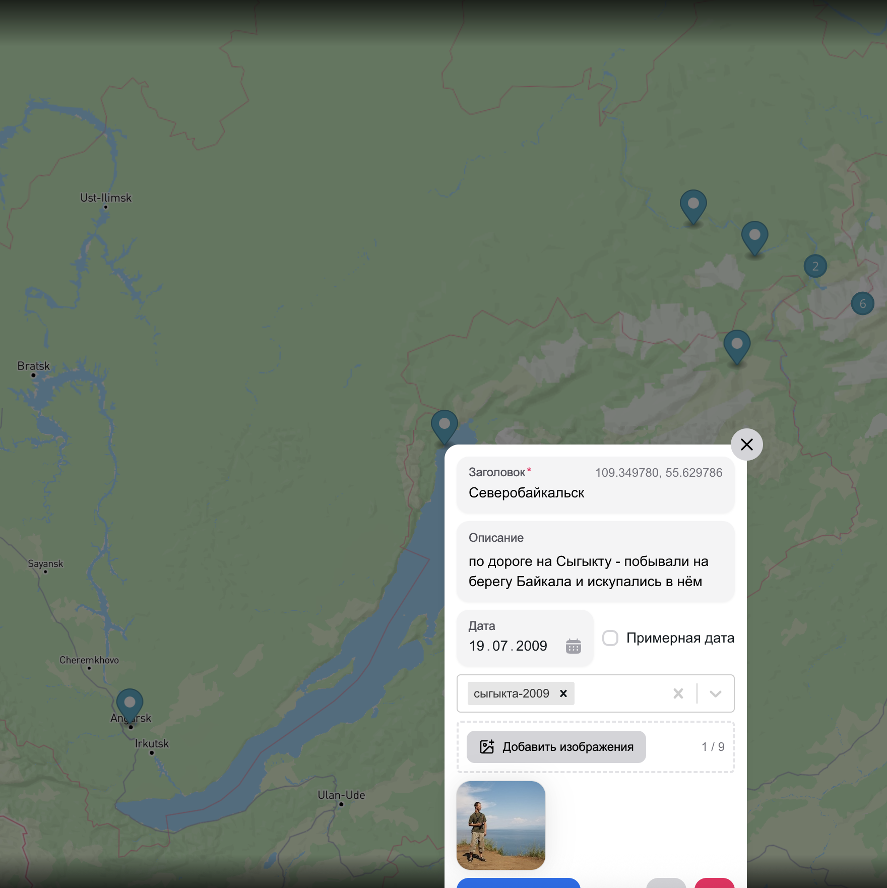
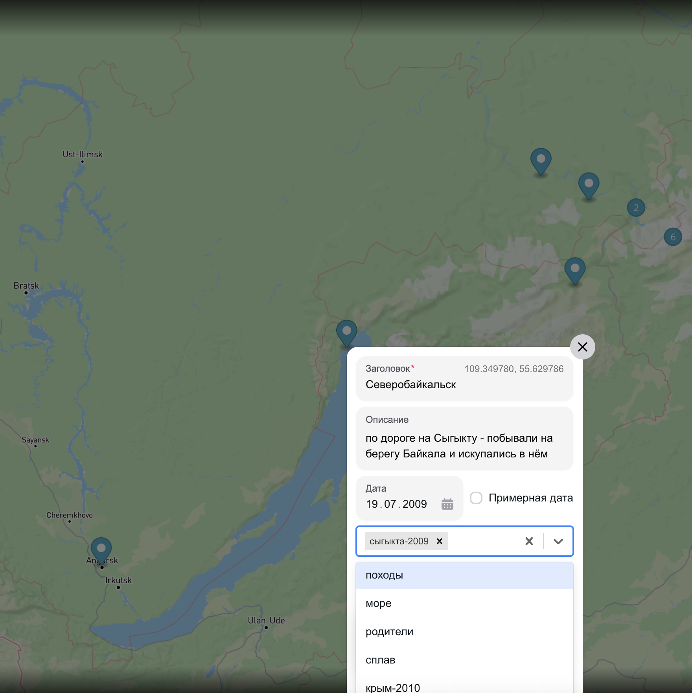
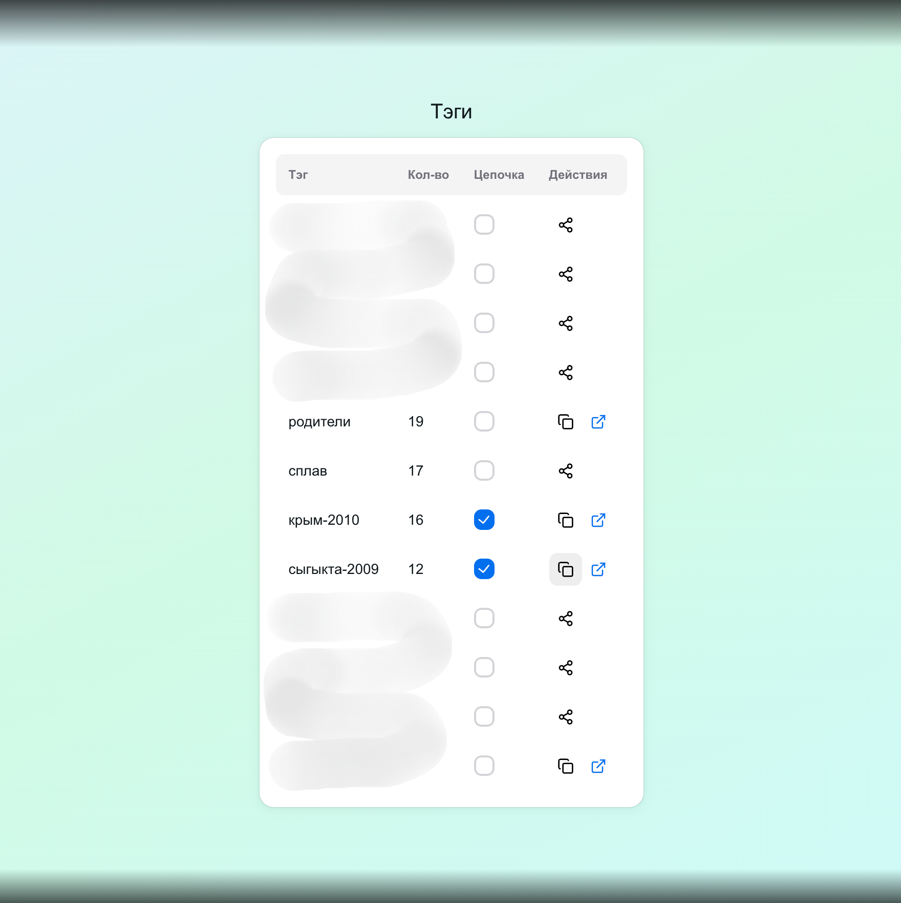
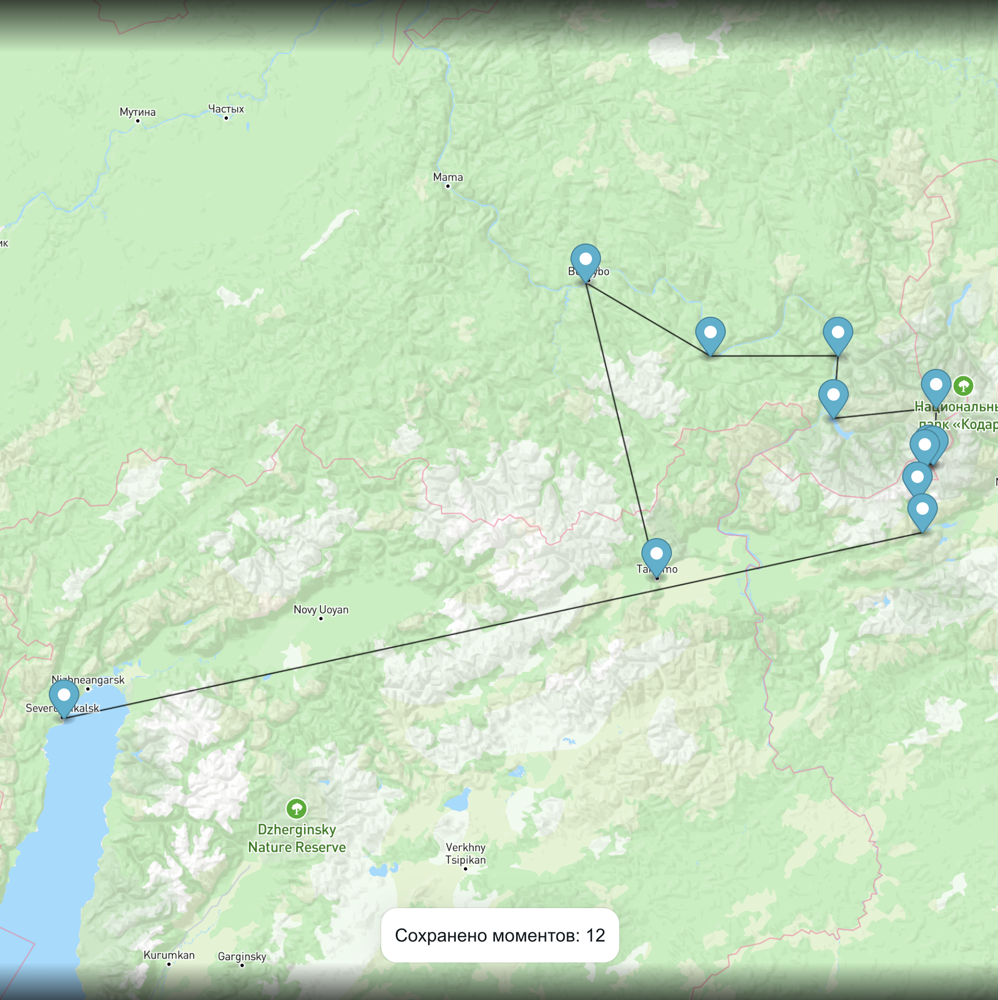
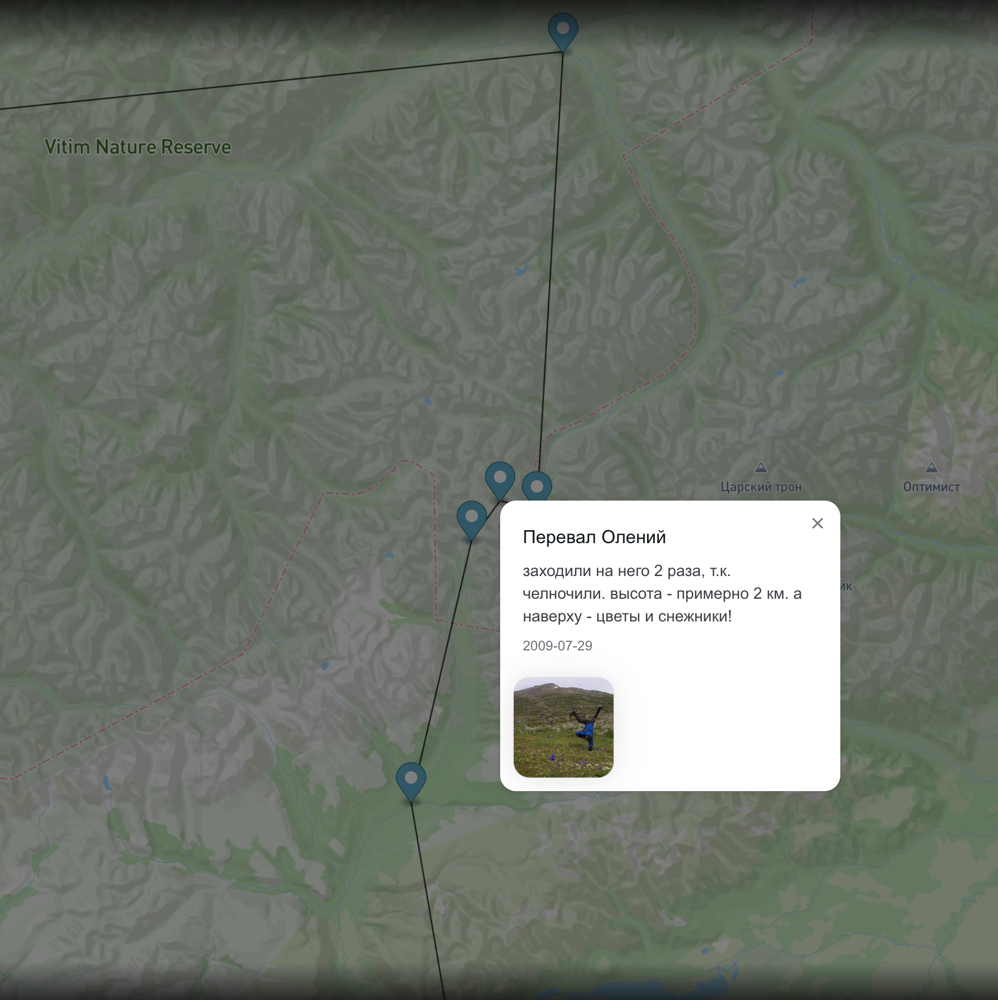

## 🌍 Map of Moments - сохрани свои памятные моменты на карте

- 🏖️ первая поездка на море 🌊
- 🌲 поход с одноклассниками 🎒
- 🍻 тусовка с друзьями 🔥
- 🎓 экватор универа 🏡
- 💍 свадебная фотосессия 📸
- 👶 выписка ребёнка 🎀
- ✈️ путешествие за границу 🌍
- 🥂 корпоратив с коллегами 👔
- ⛷️ зимний отдых в горах 🏔

Отмечай места, добавляй впечатления — и делись ими с друзьями

## 🪧 О проекте

Map of Moments — карта воспоминаний, которая связывает места и события, а в будущем, я надеюсь — и людей друг с другом.

Это сервис, где можно отмечать точки, добавлять к ним описания и даты, а также тэги и фотографии. Что именно сохранять — каждый решает сам.

Например, можно собрать все поездки по странам Европы или сплавы по горным рекам — и поделиться этими коллекциями с друзьями, переслав им публичную ссылку.

А если моменты тесно связаны, можно объединить их в «цепочку» — последовательность гео-меток, рассказывающих вашу историю в хронологическом порядке.

Это мой pet-проект, я делаю его в свободное время, поэтому многие идеи ещё не успел реализовать. Но я буду рад любым вашим отзывам и комментариям :)

## 🚀 Возможности

- Добавление точек на карту, удобную для поиска
- Сохранение описания, даты, тэгов и фотографий
- Публикация моментов по тэгу в виде ссылки
- Авторизация через почту и Google-аккаунт
- В планах: комменты, лайки и приглашения

## 🖼️ Скриншоты

<p>
  
  
  
  
</p>

<p>
  
  
  
  
</p>

## ⚙️ Технологии

- TypeScript + React + Next.js
- Supabase + PostgreSQL
- React-Query + Jotai
- Hero-UI + Tailwind
- Mapbox-GL
- Vercel

## 💾 Установка

```bash
# Клонировать репозиторий
git clone https://github.com/elhini/mapofmoments.git
cd mapofmoments

# Установить зависимости
npm install

# Запустить локально
npm run dev
```
